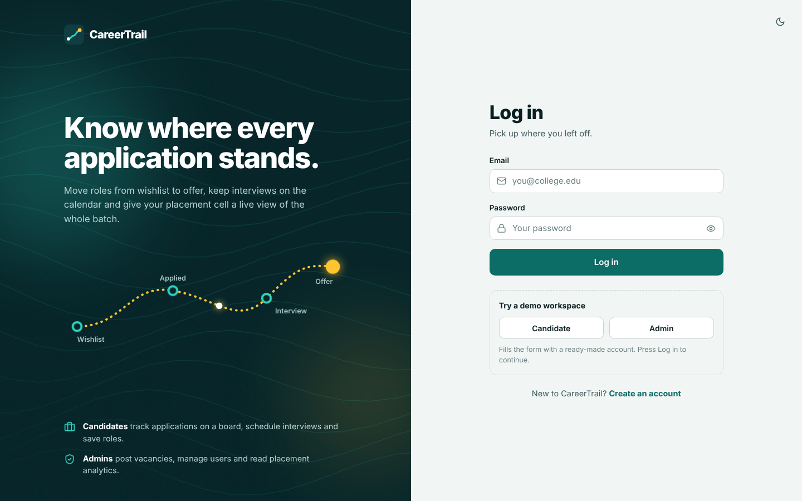

# CareerTrail

**Track every job application from wishlist to offer.** CareerTrail is a React + Vite web app with two modules: a **Candidate (User)** workspace for managing the job hunt, and an **Admin** workspace for placement officers to post vacancies, manage users and read placement analytics.

| | |
|---|---|
| **Live demo** | `https://<your-project>.vercel.app` ← replace after deploying |
| **Repository** | `https://github.com/<your-username>/careertrail` ← replace after pushing |
| **Stack** | React 19 · Vite 6 · React Router 6 · Context API · localStorage · Express + JWT (optional API) |



## Contents

- [Features](#features) · [Modules](#modules) · [Demo accounts](#demo-accounts)
- [Run locally](#run-locally) · [Deploy to Vercel](#deploy-to-vercel) · [Push to GitHub](#push-to-github)
- [System architecture](#system-architecture) · [Project structure](#project-structure)
- [Optional Express + JWT backend](#optional-express--jwt-backend)
- [Evaluation checklist](#evaluation-checklist)

## Features

- **Login and Sign up with localStorage** – accounts are stored in the browser, passwords are salted and hashed (SHA-256 via Web Crypto), sessions expire after 7 days.
- **Role-based access** – `ProtectedRoute` guards every page; wrong role shows a 403 screen, signed-out visitors go to `/login` and return to the page they asked for.
- **Candidate module** – dashboard with the pipeline drawn as a "trail", searchable job board with one-click *Easy apply*, drag-and-drop Kanban board, list view, interview scheduler with a **Join meeting / Start assessment** button (opens your Zoom, Meet, Teams or test link in a new tab), saved roles, profile with completeness meter.
- **Admin module** – analytics overview (donut + bar charts), vacancy management (post / edit / open-close / delete), user management (change role, delete), all-applications view with status updates.
- **Polished UI** – animated login (drifting terrain, travelling trail marker, staged entrances), count-up stats, page transitions, light and dark themes, fully responsive (drawer navigation and card tables on mobile), keyboard accessible dialogs, toasts, empty states, form validation.
- **Data stays yours** – export your data as JSON, reset the demo workspace any time from Settings.

## Modules

| Route | Candidate (`user`) | Admin (`admin`) |
|---|:--:|:--:|
| `/login`, `/signup` | ✅ public | ✅ public |
| `/dashboard` | Pipeline trail, interviews, openings | KPIs, charts, latest activity |
| `/profile`, `/settings` | ✅ | ✅ |
| `/jobs`, `/applications`, `/interviews`, `/saved` | ✅ | 🚫 403 |
| `/admin/jobs`, `/admin/applications`, `/admin/users` | 🚫 403 | ✅ |

## Demo accounts

| Role | Email | Password |
|---|---|---|
| Candidate | `student@careertrail.com` | `Student@123` |
| Admin | `admin@careertrail.com` | `Admin@123` |

On the login page, the **Candidate** and **Admin** buttons fill these in for you. You can also create your own account on **Sign up**. To create an **Admin** account, choose *Admin* and enter the invite code `CT-ADMIN-2026` (change it with `VITE_ADMIN_INVITE_CODE`).

## Run locally

Requires Node.js 18 or newer.

```bash
npm install
npm run dev        # http://localhost:5173
```

```bash
npm run build      # production build in dist/
npm run preview    # serve the production build on http://localhost:4173
```

No server or database is needed. The app works fully with localStorage.

## Deploy to Vercel

1. Push this repository to GitHub (steps below).
2. Go to [vercel.com/new](https://vercel.com/new) and **Import** the repository.
3. Vercel detects **Vite** automatically (the included `vercel.json` also sets the build command, the `dist` output directory and a rewrite so that deep links such as `/applications` work on refresh).
4. Click **Deploy**. Copy the live URL into the table at the top of this README.

Or with the CLI: `npm i -g vercel && vercel --prod`.

> Environment variables are optional. Without `VITE_API_URL` the app uses localStorage authentication.

## Push to GitHub

```bash
git init
git add .
git commit -m "feat: CareerTrail – React + Vite job application tracker"
git branch -M main
git remote add origin https://github.com/<your-username>/careertrail.git
git push -u origin main
```

A GitHub Actions workflow (`.github/workflows/ci.yml`) installs dependencies and runs `npm run build` on every push.

## System architecture

```
┌────────────────────────── Frontend – React + Vite ──────────────────────────┐
│  Login / Signup  →  AuthContext  →  ProtectedRoute  →  Dashboard / Profile  │
│        │                │                                     │              │
│        │          authService ── mode A (default): localStorage + hashing    │
│        │                     └── mode B (VITE_API_URL set): HTTP + JWT       │
└────────┼─────────────────────────────────────────────────────────────────────┘
         │  POST /api/auth/login   { email, password }
         ▼
┌────────────────────────── Backend – Express.js (optional) ──────────────────┐
│  Login API → validates credentials → signs JWT                              │
│  authMiddleware  → verifies Bearer token (401 if missing / invalid)         │
│  roleMiddleware  → checks the role (403 if not allowed)                     │
│  Protected APIs  → /api/student/*  (candidate)   /api/admin/*  (admin)      │
└─────────────────────────────────────────────────────────────────────────────┘
```

How a sign-in works:

1. The user enters email and password on the **Login** page.
2. `AuthContext.login()` calls `authService.login()`. In API mode this sends the request to the Express backend; in the default mode it checks the localStorage user store.
3. The credentials are validated (password hash comparison).
4. If valid, a session is created. In API mode the backend **generates a JWT**.
5. `AuthContext` keeps the authenticated user in React state (Context API) and the session in localStorage.
6. `ProtectedRoute` lets the user into the dashboard.
7. In API mode, the **Express middleware verifies the JWT** before any protected endpoint responds.
8. A missing or invalid token is rejected with **401**; the wrong role is rejected with **403**. On the frontend, an invalid session sends the user back to `/login`.

The assignment's "student" naming maps to CareerTrail like this:

| Spec | In this project |
|---|---|
| `src/context/AuthContext.jsx` | `src/context/AuthContext.jsx` |
| `src/components/ProtectedRoute.jsx` | `src/components/ProtectedRoute.jsx` |
| `pages/Login.jsx`, `Dashboard.jsx`, `Profile.jsx` | `src/pages/Login.jsx`, `Dashboard.jsx` (Candidate and Admin views), `Profile.jsx` |
| `student-portal-backend/middleware/authMiddleware.js` | `server/middleware/authMiddleware.js` |
| `…/middleware/roleMiddleware.js` | `server/middleware/roleMiddleware.js` |
| `…/routes/authRoutes.js`, `studentRoutes.js` | `server/routes/authRoutes.js`, `studentRoutes.js` (+ `adminRoutes.js`) |
| `…/.env`, `server.js` | `server/.env.example`, `server/server.js` |

## Project structure

```
careertrail/
├── index.html
├── package.json
├── vite.config.js
├── vercel.json                  # SPA rewrite + build settings for Vercel
├── .env.example
├── .github/workflows/ci.yml
├── docs/screenshots/
├── public/favicon.svg
├── src/
│   ├── main.jsx · App.jsx · index.css
│   ├── context/                 # AuthContext, DataContext, ThemeContext, ToastContext
│   ├── components/              # ProtectedRoute, AppLayout, Modal, Charts, TrailProgress …
│   ├── pages/                   # Login, Signup, Dashboard, Jobs, Applications, Interviews, Saved, Profile, Settings
│   │   └── admin/               # AdminDashboard, ManageJobs, ManageUsers, AllApplications
│   ├── services/                # authService, storage, seed data
│   └── utils/                   # constants, formatting, password hashing
└── server/                      # optional Express + JWT API
    ├── server.js
    ├── controllers/ · routes/ · middleware/ · data/ · utils/
    └── .env.example
```

## Optional Express + JWT backend

The backend implements the architecture above and can be used instead of localStorage authentication.

```bash
cd server
npm install
cp .env.example .env         # set JWT_SECRET to a long random string
npm start                    # http://localhost:5000
```

Then, in the project root, create `.env` with `VITE_API_URL=http://localhost:5000` and restart `npm run dev`.

| Method | Endpoint | Access |
|---|---|---|
| POST | `/api/auth/register` | public |
| POST | `/api/auth/login` | public – returns `{ token, user }` |
| GET | `/api/auth/me` | any valid JWT |
| PUT | `/api/auth/profile` · `/api/auth/password` | any valid JWT |
| GET | `/api/student/profile` · `/api/student/dashboard` | JWT + `user` role |
| GET | `/api/admin/users` | JWT + `admin` role |

The server seeds the same two demo accounts on first start (users are kept in `server/data/db.json`). In API mode, applications and vacancies are still stored in the browser; only authentication and the user profile go through the API.

## Evaluation checklist

| Requirement | Where |
|---|---|
| React + Vite project | `package.json`, `vite.config.js`, `src/` |
| Modules identified and implemented (Admin, User) | `src/pages/` (Candidate) and `src/pages/admin/` (Admin), role-guarded in `src/App.jsx` |
| Login and Signup using localStorage | `src/services/authService.js`, `src/pages/Login.jsx`, `Signup.jsx` |
| AuthContext + Protected Routes | `src/context/AuthContext.jsx`, `src/components/ProtectedRoute.jsx` |
| Express backend: login, JWT, auth and role middleware, protected APIs | `server/` |
| Vercel deployment | `vercel.json` + [instructions](#deploy-to-vercel) |
| GitHub repository | [instructions](#push-to-github) |

## Notes

- localStorage authentication is designed for demos and coursework. Anyone with access to the browser can read its storage, so do not store real credentials. Use the Express backend (with a real database) for production.
- Data is per browser. Clearing site data resets the workspace to the demo data.

## License

MIT – see [LICENSE](LICENSE).
